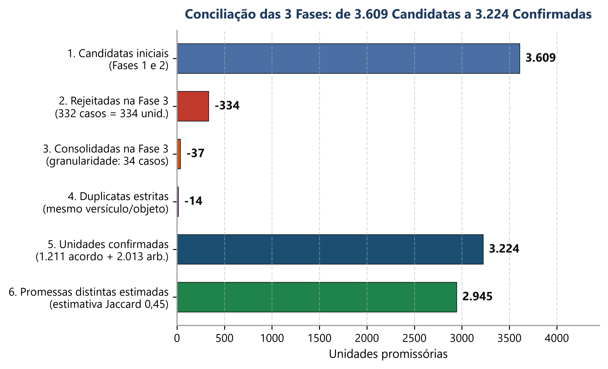
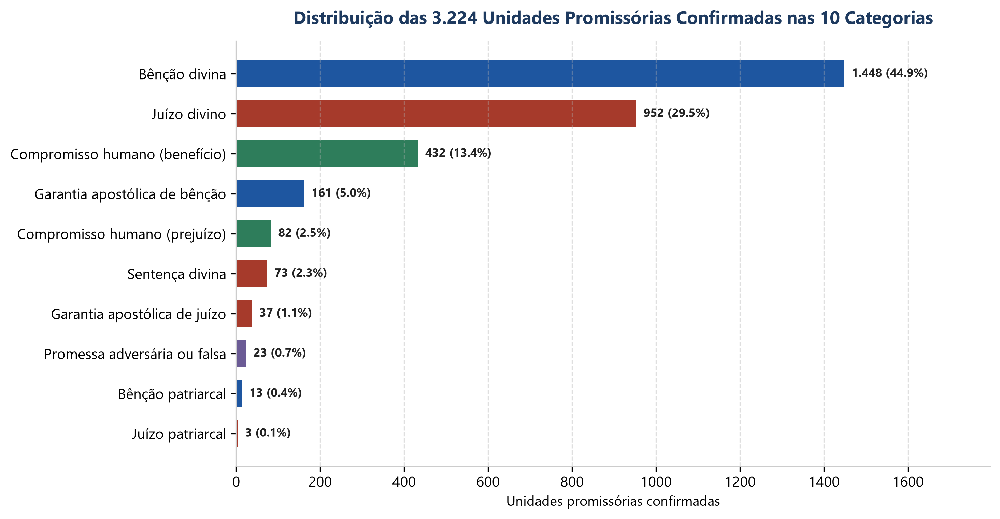
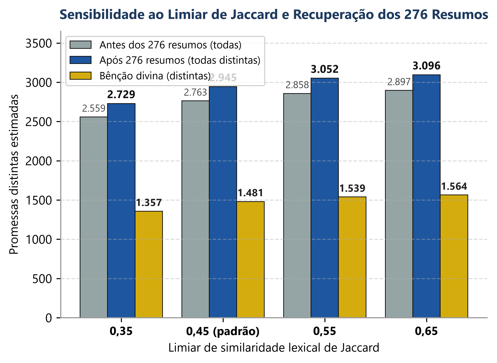

# Quantas promessas existem na Bíblia? Uma análise computacional e exegética dos 66 livros do cânon protestante

# How Many Promises Are in the Bible? A Computational and Exegetical Analysis of the 66 Books of the Protestant Canon

**Autor / Author:** Jair Lima  
**Afiliação / Affiliation:** Lima Editora do Brasil; Assembleia de Deus de Três Coroas, Rio Grande do Sul, Brasil  
**Data / Date:** 24 de novembro de 2026  
**Versão dos dados / Data version:** v1.0.0 (`Promessas-da-Biblia-by-Jair-Lima`)  
**Status editorial:** Preprint de pesquisa, ainda não avaliado por pares / *Research preprint, not yet peer-reviewed*

---

## Resumo

Quantificar as promessas bíblicas exige distinguir compromissos de outras formas de discurso presentes nas Escrituras. Este estudo investiga a totalidade dos 66 livros, 1.189 capítulos e 31.104 versículos do cânon protestante, tendo como referência a Bíblia Almeida Livre. A metodologia combina definição operacional de promessa, duas análises textuais independentes assistidas por computador, arbitragem das divergências e consolidação dos registros. Das 3.609 unidades inicialmente identificadas, 3.224 foram confirmadas segundo os critérios adotados, abrangendo 4.373 versículos (14,1% do corpus). O agrupamento dos registros por similaridade lexical, no limiar de Jaccard de 0,45, identificou 2.945 promessas distintas estimadas. O indicador de bênção divina reuniu 1.622 unidades, correspondentes a 1.481 compromissos distintos estimados. A comparação com a contagem histórica de 8.810 promessas atribuída a Everek R. Storms demonstra que essa cifra não foi reproduzida pelo método empregado. A contribuição do estudo consiste na organização de um catálogo estruturado, com critérios explícitos, memória de cálculo e documentação aberta à verificação. Os resultados oferecem uma base para novas investigações em teologia bíblica, exegese e humanidades digitais, sem pretender estabelecer uma quantidade absoluta de promessas independente dos critérios de leitura.

**Palavras-chave:** Promessas bíblicas; Teologia bíblica; Exegese bíblica; Teoria dos atos de fala; Linguística de corpus; Humanidades digitais.

---

## Abstract

Quantifying biblical promises requires distinguishing commitments from other forms of discourse in Scripture. This study examines all 66 books, 1,189 chapters and 31,104 verses of the Protestant canon, using the Bíblia Almeida Livre as its reference text. The methodology combines an operational definition of promise, two independent computer-assisted textual analyses, arbitration of disagreements and consolidation of records. Of the 3,609 initially identified units, 3,224 were confirmed under the adopted criteria, spanning 4,373 verses (14.1% of the corpus). Lexical clustering at a Jaccard threshold of 0.45 produced an estimate of 2,945 distinct promises. The divine blessing indicator comprised 1,622 units, corresponding to an estimated 1,481 distinct commitments. Comparison with the historical tally of 8,810 promises attributed to Everek R. Storms shows that this figure was not reproduced by the method employed. The contribution of this study lies in a structured catalogue, explicit criteria, calculation records and documentation open to scrutiny. The findings provide a foundation for further research in biblical theology, exegesis and digital humanities, without claiming an absolute number of promises independent of interpretive criteria.

**Keywords:** Biblical promises; Biblical theology; Biblical exegesis; Speech act theory; Corpus linguistics; Digital humanities.

---

## 1. Introdução

A quantificação de fenômenos textuais nas Escrituras possui longa tradição na filologia bíblica, desde as contagens dos massoretas até a moderna linguística de corpus. Contar promessas, contudo, exige mais do que localizar palavras ou formas verbais: é necessário identificar o compromisso expresso, sua origem, seu destinatário e sua relação com o contexto.

As cifras de 8.810 promessas no total e de 7.487 promessas de Deus ao ser humano, atribuídas a Everek R. Storms, difundiram-se na literatura de divulgação bíblica. Outras estimativas também circulam no meio devocional. A Escritura, porém, não estabelece uma quantidade oficial de promessas, e os totais dependem dos critérios empregados para identificá-las e segmentá-las.

O presente estudo propõe uma investigação integral e documentada do cânon protestante, organizada em três fases de identificação, conferência e arbitragem. A contribuição reside na associação entre uma definição operacional explícita, a classificação de cada unidade, a identificação de seus interlocutores e a disponibilização de dados que permitem examinar os resultados. O catálogo consolidado reúne 3.224 unidades promissórias, acompanhado de procedimentos de cálculo e documentação metodológica.

A questão central é teológica e exegética: compreender o que constitui uma promessa nas Escrituras, verificando sua distribuição e distinguindo compromissos divinos, humanos e adversários. Os recursos computacionais empregados servem a essa finalidade.

---

## 2. Revisão da Literatura

A literatura pertinente ao problema divide-se em três tradições principais:

1. **Antologias Temáticas e Recenseamentos Manuais (Séculos XVIII a XX):**
   Em 1720, o clérigo inglês não conformista Samuel Clarke (1684 a 1750) publicou *A Collection of the Promises of Scripture, under their Proper Heads* (Londres: J. Clark; 2ª ed. 1738 com prefácio de Isaac Watts), organizando promessas de bênção temporal, espiritual e eterna por categorias pastorais. Em meados da década de 1950, o professor canadense Everek R. Storms (Kitchener, Ontário), insatisfeito com a alegação popular de que existiriam 30.000 promessas na Bíblia, realizou ao longo de dezoito meses, durante sua vigésima sétima leitura bíblica, uma contagem manual que totalizou **8.810 promessas**, subdivididas em **7.487** promessas de Deus ao homem, **991** de um ser humano a outro, **290** do homem a Deus, **28** de anjos, **9** de Satanás, **2** de Deus Pai a Deus Filho, **2** de espíritos malignos ao Senhor e **1** de um homem a um anjo (noticiada pela revista *Time*, v. 68, n. 26, p. 49, 24 dez. 1956, seção *Religion*, sob o título "Promises"). Em 1962, Herbert Lockyer publicou *All the Promises of the Bible* (Grand Rapids: Zondervan, 1962, p. 10), difundindo amplamente o recenseamento de Storms. Apesar de seu valor histórico, o levantamento de Storms não foi localizado, nas fontes consultadas para este artigo, em formato de catálogo estruturado versículo a versículo que permita conferir suas decisões de segmentação.
2. **Teoria dos Atos de Fala e Hermenêutica Bíblica:**
   A filosofia da linguagem ordinária (Austin, 1962; Searle, 1969, 1979) e sua recepção na hermenêutica bíblica (Thiselton, 1992; Vanhoozer, 1998; Briggs, 2001) demonstraram que uma *promessa* pertence à classe dos **atos ilocucionários comissivos** (*commissives*): enunciados cujo propósito ilocucionário é comprometer o falante (*promisor*) com a realização de um curso futuro de ação em relação a um destinatário. Essa distinção teórica é crucial para a exegese de corpus, pois separa atos comissivos de atos *diretivos* (mandamentos e exortações), *assertivos* (relatos históricos consumados, descrições de atributos divinos e afirmações doutrinárias em terceira pessoa) e *expressivos* (orações, desejos e bênçãos votivas humanas).
3. **Linguística de corpus e humanidades digitais:**
   Recursos como ETCBC/BHSA (Roorda; Van Peursem et al., 2018), MACULA (Clear Bible, Inc., 2023) e STEPBible (Tyndale House, 2023) exemplificam a organização computacional de informações linguísticas sobre os textos bíblicos. O presente estudo utiliza uma abordagem complementar, voltada à identificação e classificação de compromissos promissórios. A aplicação de procedimentos computacionais à interpretação do corpus permite organizar os dados e explicitar decisões, sem eliminar a necessidade de avaliação exegética.

---

## 3. Questão de Pesquisa e Definição Operacional

### 3.1. Questões de Pesquisa
1. Quantas unidades textuais promissórias (atos comissivos) são identificáveis nos 31.104 versículos dos 66 livros do cânon protestante quando submetidas a dupla leitura independente e arbitragem exegética de terceira fase?
2. Como essas unidades se distribuem entre promessas divinas de bênção, promessas divinas de juízo/sentença, garantias apostólicas e patriarcais, compromissos humanos e promessas adversárias?
3. Qual é o total de **promessas distintas estimadas** quando se desconta a redundância de reafirmações por agrupamento de similaridade lexical, e por que o resultado diverge da cifra histórica de Everek R. Storms (8.810 / 7.487)?

### 3.2. Definição Operacional de Promessa
Define-se operacionalmente uma **unidade promissória** como toda declaração textual do corpus que:
1. Atribui a um **promitente identificável** (Deus Pai, Filho, Espírito Santo, Deus sem distinção de pessoa, mensageiro autorizado, patriarca, apóstolo, agente humano em nome próprio ou voz adversária) o **compromisso verificável** de realizar, garantir, manter ou executar algo futuro ou continuado;
2. Possui **conteúdo (objeto prometido)** e **destinatário reconhecível** (indivíduo, família/linhagem, Israel, Igreja, grupo específico, nações, humanidade ou criação), além de condição explícita ou contextual quando o próprio texto a estabelece;
3. Distingue a **origem do compromisso** (`origem_real`) da identidade do **comunicador humano** que relata, profetiza ou recorda a palavra.

**Critérios de exclusão (Não Promessas):**
Não são contabilizadas como promessas: (a) mandamentos e imperativos de tarefa sem garantia de benefício; (b) desejos, saudações ou bênçãos votivas humanas sem obrigação assumida pelo falante (ex.: *"O SENHOR te abençoe"*, *"Viva o rei"*); (c) relatos históricos de fatos já consumados sem efeito futuro projetado; (d) princípios sapienciais e máximas gerais de causa e efeito moral sem falante que se obrigue em primeira pessoa (ex.: provérbios gerais); (e) declarações doutrinárias ou confissões teológicas em terceira pessoa sobre atributos ou atos universais de Deus sem estrutura de oráculo promissório (ex.: Ec 12.14; Lm 3.22-32); e (f) votos devocionais do homem a Deus.

---

## 4. Corpus e Metodologia das Três Fases

### 4.1. Corpus Textual
O corpus único utilizado é a **Bíblia Almeida Livre** (Lima, 2026), licenciada sob *Creative Commons Atribuição-SemDerivações 4.0 Internacional* (CC BY-ND 4.0), composta pelos **66 livros** do cânon protestante (39 do Antigo Testamento e 27 do Novo Testamento), **1.189 capítulos** e **31.104 versículos** canônicos auditados por hash criptográfico SHA-256 (`manifesto_sha256.txt`).

### 4.2. Procedimentos metodológicos

O estudo foi organizado em três fases, sob critérios de inclusão e exclusão comuns. As análises textuais e a arbitragem foram executadas com auxílio de modelos de linguagem, em contextos separados, sem acesso aos resultados da outra leitura durante as duas fases iniciais. Na terceira fase, empregou-se um sistema distinto dos dois utilizados na análise daquele livro. Essa separação é operacional e não implica independência estatística dos resultados.

**Fase 1: identificação inicial.** Análise capítulo a capítulo dos 66 livros, com registro da cobertura dos versículos, localização da passagem, origem, natureza, promitente, destinatário e condição. As âncoras textuais foram conferidas com o corpus de referência.

**Fase 2: conferência independente.** Segunda análise integral dos 1.189 capítulos, sem acesso aos resultados da primeira. Na reconciliação, os registros foram associados por sobreposição de versículos e similaridade lexical da âncora (limiar de 0,12). Foram confirmadas 1.211 unidades por concordância direta.

**Fase 3: arbitragem exegética assistida por computador.** Os casos de identificação unilateral ou divergência de origem, natureza ou granularidade foram submetidos à terceira avaliação. A fase complementar abrangeu 1.808 casos dos 56 livros restantes, além das adjudicações anteriormente realizadas. No catálogo final, 2.013 unidades foram confirmadas por arbitragem ao longo da pesquisa.

### 4.3. Consolidação e controle de qualidade

Foram recuperados 276 resumos inicialmente ausentes: 202 a partir da análise complementar e 74 com base nas âncoras e no texto bíblico. A distinção entre promitente e comunicador humano foi explicitada nos registros de origem divina ou garantia apostólica; 1.487 registros possuem identificação do comunicador. Em 1Cr 11.2, por exemplo, o povo de Israel recorda uma palavra atribuída ao Senhor. Foram também removidas 14 duplicatas técnicas estritas, identificadas pela mesma referência, categoria e objeto prometido.

A conferência programática da estrutura dos registros, das âncoras literais e da conciliação aritmética complementou a classificação automatizada. Os parâmetros, versões das ferramentas, registros de execução e decisões de arbitragem devem permanecer na documentação técnica vinculada à versão do conjunto de dados, permitindo a avaliação do procedimento sem confundir a ferramenta com a autoria intelectual.

---

## 5. Resultados

### 5.1. Indicadores Globais e Conciliação Aritmética das Três Fases
A Tabela 1 apresenta a síntese quantitativa oficial e a conciliação exata entre o levantamento preliminar das Fases 1 e 2 e o fechamento definitivo pós-Fase 3.

**Tabela 1: Indicadores globais e conciliação aritmética da pesquisa**

| Indicador / Etapa metodológica | Quantidade | Proporção / Observação |
| :--- | ---: | :--- |
| Livros bíblicos examinados | 66 | 39 AT / 27 NT (100% do cânon protestante; 64 livros com registros) |
| Capítulos examinados | 1.189 | 100% dos capítulos |
| Versículos examinados | 31.104 | 100% dos versículos do corpus |
| Unidades candidatas preliminares (Fases 1 e 2) | 3.609 | Levantamento bruto antes da Fase 3 |
| Casos divergentes submetidos ao árbitro (Fase 3) | 1.808 | Continham 1.882 unidades preliminares |
| $( - )$ Unidades em casos rejeitados pelo árbitro (Fase 3) | $-334$ | 332 casos rejeitados (2 casos tinham 2 unidades) |
| $( - )$ Subdivisões consolidadas por granularidade (Fase 3) | $-37$ | 34 casos confirmados na formulação mais coesa |
| $( - )$ Duplicatas técnicas estritas removidas | $-14$ | Mesmo versículo, categoria e objeto prometido |
| **$( = )$ Unidades promissórias confirmadas (Total Final)** | **3.224** | **Zero candidatos ou divergências pendentes** |
| $\quad$ • Confirmadas por acordo direto (Fases 1 e 2) | 1.211 | 37,6% das unidades confirmadas |
| $\quad$ • Confirmadas por arbitragem independente (Fase 3) | 2.013 | 62,4% das unidades confirmadas |
| Versículos únicos cobertos por promessas confirmadas | 4.373 | **14,1%** de todos os versículos da Bíblia |
| **Promessas distintas estimadas (Jaccard $\tau = 0,45$)** | **2.945** | Faixa de sensibilidade: 2.729 ($\tau=0,35$) a 3.096 ($\tau=0,65$) |
| Projeção de distintas corrigida pela revocação ($0,84$) | 3.506 | Cenário ilustrativo de extrapolação |
| **Indicador Principal: Bênção Divina (Unidades)** | **1.622** | 50,3% de todas as unidades promissórias |
| **Indicador Principal: Bênção Divina (Distintas, $\tau = 0,45$)** | **1.481** | Até 1.763 com correção pela revocação ($0,84$) |

A conciliação matemática entre os **1.808 casos arbitrados** na Fase 3 e os **1.843 resultados de unidades** (`1.511 unidades confirmadas + 332 casos rejeitados`) decorre do fato de que, dos 1.808 casos, **332 casos** foram rejeitados e **1.476 casos** foram confirmados (`332 + 1.476 = 1.808`). Como **32 dos 1.476 casos confirmados** continham múltiplas promessas distintas no mesmo trecho (30 casos com 2 unidades, 1 caso com 3 unidades e 1 caso com 4 unidades, somando $+35$ unidades), os 1.476 casos confirmados geraram exatamente **1.511 unidades confirmadas** (`1.476 + 35 = 1.511`).

Por sua vez, a diferença de **39 unidades** entre a subtração simples `3.609 - 332 - 14 = 3.263` e o total final de **3.224** explica-se pela soma das **2 unidades adicionais** existentes nos 2 casos rejeitados que possuíam 2 subdivisões preliminares (`334 - 332 = 2`) com as **37 subdivisões excedentes** consolidadas pelo árbitro nos 34 casos confirmados em que o catálogo preliminar havia tomado provisoriamente a análise com maior número de subdivisões (`2 + 37 = 39`).

### 5.2. Análise das Dez Categorias Promissórias
A Tabela 2 detalha a distribuição das **3.224 unidades confirmadas** nas dez categorias taxonômicas da pesquisa.

**Tabela 2: Distribuição das unidades confirmadas por categoria taxonômica**

| Categoria Taxonômica | Código | Origem e Natureza | Unidades | % do Total |
| :--- | :--- | :--- | ---: | ---: |
| **Bênção divina** *(Indicador Principal)* | `divina_bencao` | Divina direta ou relatada / Bênção | 1.448 | 44,91% |
| **Juízo divino** | `divina_juizo` | Divina direta ou relatada / Juízo | 952 | 29,53% |
| **Compromisso humano (benefício)** | `humana_beneficio` | Humana em nome próprio / Benefício | 432 | 13,40% |
| **Garantia apostólica de bênção** *(Ind. Principal)* | `apostolica_garantia_bencao` | Autoridade apostólica / Bênção | 161 | 4,99% |
| **Compromisso humano (prejuízo)** | `humana_prejuizo` | Humana em nome próprio / Prejuízo | 82 | 2,54% |
| **Sentença divina** | `divina_sentenca` | Divina em forma de sentença / Juízo | 73 | 2,26% |
| **Garantia apostólica de juízo** | `apostolica_garantia_juizo` | Autoridade apostólica / Juízo | 37 | 1,15% |
| **Promessa adversária ou falsa** | `adversaria_ou_falsa` | Voz adversária ou falso profeta | 23 | 0,71% |
| **Bênção patriarcal** *(Indicador Principal)* | `patriarcal_bencao` | Profética patriarcal (Gênesis) / Bênção | 13 | 0,40% |
| **Juízo patriarcal** | `patriarcal_juizo` | Profética patriarcal (Gênesis) / Juízo | 3 | 0,09% |
| **TOTAL CONFIRMADO** | | | **3.224** | **100,00%** |

Observa-se que as promessas de origem divina ou apostólica/patriarcal inspirada somam **2.687 unidades (83,34%)**, divididas entre **1.622 unidades de bênção divina (50,31%)** e **1.065 unidades de juízo e sentença divina (33,03%)**. Os compromissos humanos em nome próprio respondem por **514 unidades (15,94%)**, e as promessas de voz adversária ou falsa (como as ofertas enganosas da serpente em Gn 3.4-5, do diabo na tentação de Cristo em Mt 4.9/Lc 4.6-7 e de falsos profetas como Hananias em Jr 28) somam **23 unidades (0,71%)**.

### 5.3. Distribuição pelas Divisões do Cânon e Comportamento dos Livros Sapienciais
A distribuição das 3.224 unidades pelas sete divisões canônicas (cuja soma exata é $1.006 + 560 + 595 + 332 + 344 + 289 + 98 = 3.224$) revela forte concentração na literatura profética e nas narrativas de aliança:
1. **Profetas Maiores (Isaías a Daniel):** **1.006 unidades (31,20%)**, liderados por Jeremias (389), Isaías (350) e Ezequiel (241), além de Daniel (26) e Lamentações (0), onde se concentram tanto os oráculos de juízo sobre Judá e as nações quanto as grandes promessas messiânicas e de restauração da Nova Aliança.
2. **Pentateuco (Gênesis a Deuteronômio):** **560 unidades (17,37%)**, com destaque para Gênesis (181), Êxodo (132), Deuteronômio (132), Números (79) e Levítico (36).
3. **Livros Históricos do AT (Josué a Ester):** **595 unidades (18,46%)**, com alta presença de compromissos reais, aliança davídica (2Sm 7; 1Cr 17) e palavras proféticas na monarquia (1Sm: 108; 1Rs: 94; 2Sm: 71; 2Rs: 71; Jz: 63; Js: 53; 2Cr: 51; 1Cr: 34; Ne: 16; Et: 16; Ed: 10; Rt: 8).
4. **Profetas Menores (Oseias a Malaquias):** **332 unidades (10,30%)**, destacando-se Oseias (72), Zacarias (67) e Amós (56).
5. **Evangelhos e Atos (Mateus a Atos):** **344 unidades (10,67%)**, com altíssima densidade de bênção divina nas palavras de Cristo em João (94 unidades, sendo 86 de bênção), Lucas (89), Mateus (79), Atos (51) e Marcos (31).
6. **Epístolas e Apocalipse (Romanos a Apocalipse):** **289 unidades (8,96%)**, lideradas por Romanos (58), Apocalipse (46), 1 Coríntios (32), Hebreus (28) e 2 Coríntios (22).
7. **Poéticos e Sapienciais (Jó a Cantares):** **98 unidades (3,04%)**, concentradas nos Salmos (82 unidades, sobretudo salmos reais, messiânicos e oráculos divinos como Sl 2, 50, 89, 91, 110 e 132), Jó (11), Cantares (4) e Provérbios (1), com Eclesiastes (0).

**Análise específica de Provérbios (1), Eclesiastes (0) e Lamentações (0):**
A baixa contagem nos livros estritamente sapienciais e elegíacos é consequência direta e intencional da definição operacional comissiva:
* Em **Provérbios**, as análises identificaram mais de 600 unidades de *princípios sapienciais* (`principio_sapiencial`), isto é, observações gerais sobre a ordem moral do mundo sem um promitente que assuma obrigação pessoal em primeira pessoa. O único registro confirmado como ato comissivo explícito é **Pv 1.13-14** (`P-PRO-0001`), onde um falante coletivo definido (os pecadores que convidam o jovem) assume compromisso em primeira pessoa do plural do futuro (*"Encontraremos toda sorte de bens preciosos; encheremos nossas casas de despojos"*).
* Em **Eclesiastes (0 unidades)**, foram mapeados 90 princípios sapienciais e 41 declarações doutrinárias sem compromisso. Passagens como **Ec 11.9** e **Ec 12.14** (*"Porque Deus há de trazer a juízo toda obra, e até tudo o que está encoberto, quer seja bom, quer seja mau"*) constituem afirmações doutrinárias em terceira pessoa proferidas pelo Pregador para fundamentar o dever moral de temer a Deus (Ec 12.13), e não oráculos em que Deus toma a palavra como promitente.
* Em **Lamentações (0 unidades)**, as duas análises convergiram na ausência de atos comissivos diretos nos 154 versículos; passagens célebres de esperança, como **Lm 3.22-32**, são meditações e confissões do poeta sobre os atributos de misericórdia e fidelidade do Senhor, sem estrutura ilocucionária de promessa direta.

### 5.4. Impacto da Recuperação dos 276 Resumos e Sensibilidade ao Limiar de Jaccard
Na consolidação preliminar, 276 registros oriundos de análises com preenchimento parcial continham o marcador padronizado `"(resumo não informado pelo leitor)"`. Como o algoritmo de agrupamento lexical (`apurar_numero.py`) calcula o índice de Jaccard sobre termos de 4 ou mais letras dentro da mesma categoria, essas 276 unidades compartilhavam exatamente o conjunto de termos `{'resumo', 'informado', 'pelo', 'leitor'}` ($J = 1,00$), colapsando artificialmente em um único grupo por categoria e subestimando o resultado preliminar em 2.763 compromissos distintos.

Após a recuperação integral dos 276 resumos reais (zerando os resumos genéricos), o agrupamento lexical foi recalculado nos quatro limiares de sensibilidade (Tabela 3), resultando no valor central ($\tau = 0,45$) de **2.945 promessas distintas estimadas** ($+182$) e, para o indicador principal de bênção divina, em **1.481 promessas distintas estimadas** ($+57$).

**Tabela 3: Sensibilidade das promessas distintas estimadas ao limiar de Jaccard ($\tau$)**

| Limiar de Jaccard ($\tau$) | Promessas distintas estimadas (Todas) | Projeção c/ Revocação 0,84 (Todas) | Bênção Divina (Distintas estimadas) | Bênção Divina (Projeção c/ Revocação) |
| :---: | ---: | ---: | ---: | ---: |
| $0,35$ | 2.729 | 3.249 | 1.357 | 1.615 |
| **$0,45$ (Padrão)** | **2.945** | **3.506** | **1.481** | **1.763** |
| $0,55$ | 3.052 | 3.633 | 1.539 | 1.832 |
| $0,65$ | 3.096 | 3.686 | 1.564 | 1.862 |

---

## 6. Discussão e Comparação com Contagens Históricas

A Tabela 4 confronta os resultados do presente levantamento com a contagem manual realizada por Everek R. Storms em meados da década de 1950.

**Tabela 4: Comparação entre o recenseamento de Everek R. Storms (1956) e a pesquisa atual (Lima, 2026)**

| Dimensão / Categoria | Everek R. Storms (1956) | Pesquisa Atual: Jair Lima (2026) | Razão Metodológica da Diferença |
| :--- | ---: | ---: | :--- |
| **Total geral de promessas registradas** | 8.810 | **3.224 unidades** (**2.945 distintas estimadas**) | Os critérios completos de segmentação de Storms não foram recuperados; a pesquisa atual aplica definição operacional explícita. |
| **Promessas de origem divina (totais segundo cada classificação)** | 7.487 | **2.687 unidades** (1.622 bênção + 1.065 juízo) | Categorias não necessariamente equivalentes; a pesquisa atual exige compromisso identificável. |
| **Promessas divinas de bênção** | Não separado de juízos no total de 7.487 | **1.622 unidades** (**1.481 distintas estimadas**) | Separação explícita entre natureza de `bencao` (1.622) e natureza de `juizo`/sentença (1.065). |
| **Compromissos humanos** | 991 | **514 unidades** (432 benefício + 82 prejuízo) | Exclusão de ofertas já esgotadas no próprio ato narrativo e de saudações/desejos votivos sem obrigação futura. |
| **Votos do homem a Deus** | 290 | Sem categoria isolada comparável | A exclusão de votos devocionais segue a definição adotada; a equivalência com os registros históricos não foi demonstrada. |
| **Promessas de Satanás / vozes adversárias** | 11 (9 Satanás + 2 espíritos) | **23 unidades** | Inclui Satanás/serpente e falsos profetas ou inimigos que prometem em oposição a Deus (ex.: Hananias, Senaqueribe/Rabsaqué). |
| **Auditabilidade registro a registro** | Catálogo individual não localizado | Registros disponíveis para auditoria (3.224 registros c/ ID, âncora e JSONL) | Catálogo e documentação metodológica permitem conferência dos registros. |

A diferença entre os totais deve ser interpretada à luz das definições operacionais e das unidades de contagem. A documentação histórica citada não permite reconstruir, caso a caso, todas as escolhas de segmentação de Storms. Portanto, não se pode atribuir a diferença exclusivamente a um procedimento específico do levantamento anterior, nem concluir que ele seja falso apenas por divergir do resultado atual.

### 6.1. Originalidade e contribuição científica da pesquisa

O confronto com a literatura histórica e com os recursos contemporâneos de linguística de corpus permite delimitar a originalidade e a contribuição científica desta investigação em cinco eixos complementares, sem reivindicar prioridade mundial absoluta sobre iniciativas não indexadas nas bases consultadas:

1. **Investigação integral do cânon associada a definição operacional explícita:** em vez de compilar seleções temáticas devocionais (como na tradição iniciada por Samuel Clarke em 1720) ou divulgar apenas somatórios agregados sem lista verificável passagem por passagem (como no recenseamento de Everek R. Storms noticiado em 1956), o estudo examinou os 31.104 versículos dos 66 livros do cânon protestante sob um critério ilocucionário comissivo uniforme e documentado.
2. **Arquitetura de conferência cruzada e arbitragem exegética das divergências:** a organização em três etapas metodológicas impediu que identificações unilaterais ingressassem automaticamente no catálogo final, submetendo todos os 1.808 casos divergentes à avaliação de terceira etapa e documentando a rejeição de 332 casos de falsos positivos e a consolidação de 37 subdivisões excedentes.
3. **Taxonomia em dez categorias e distinção entre promitente e comunicador humano:** o conjunto de dados separa sistematicamente bênção divina, juízo divino, sentença divina, garantias apostólicas, bênçãos e juízos patriarcais, compromissos humanos e promessas adversárias, além de distinguir a origem divina do compromisso da identidade do comunicador humano em 1.487 registros (como em 1Cr 11.2).
4. **Distinção rigorosa entre unidades textuais e compromissos distintos com análise de sensibilidade:** a combinação entre o catálogo bruto (3.224 unidades confirmadas) e o agrupamento por similaridade lexical de Jaccard (2.945 promessas distintas estimadas em $\tau = 0,45$, com faixa documentada entre 2.729 em $\tau = 0,35$ e 3.096 em $\tau = 0,65$) explicita matematicamente o papel das reafirmações pactuais ao longo das Escrituras.
5. **Ciência aberta e reprodutibilidade integral:** a disponibilização pública dos registros estruturados (em CSV, XLSX e JSONL por livro), da memória de cálculo aritmética e dos procedimentos de validação oferece uma camada pragmático-teológica verificável que complementa os corpora morfossintáticos existentes (ETCBC/BHSA, MACULA e STEPBible).

---

## 7. Limitações

1. **Dependência hermenêutica.** As fronteiras entre promessa, advertência, profecia e declaração doutrinária dependem dos critérios exegéticos adotados. A exclusão de determinadas passagens sapienciais ou doutrinárias pode ser contestada sob outra definição de promessa.
2. **Similaridade lexical.** O total de 2.945 promessas distintas estimadas depende do limiar de Jaccard de 0,45 e da qualidade dos resumos. Formulações diferentes podem expressar o mesmo compromisso, assim como formulações semelhantes podem referir-se a compromissos diferentes.
3. **Corpus em tradução.** A investigação utilizou a Bíblia Almeida Livre em português, sem análise morfossintática direta e integral dos textos hebraico, aramaico e grego.
4. **Validação metodológica.** A identificação e a arbitragem foram realizadas com auxílio de sistemas automatizados, sob critérios definidos pelo autor e verificações programáticas. A conferência amostral e os controles de consistência não equivalem à revisão humana individual de todos os versículos e registros. A separação operacional das análises não exclui erros correlacionados.
5. **Estimativa de cobertura.** A revocação de 0,84 foi medida nos pilotos de calibração, não em todo o corpus. A projeção de 3.506 compromissos distintos é um cenário ilustrativo condicionado à extrapolação dessa taxa, não um limite superior demonstrado ou intervalo de confiança. A ausência de candidatos pendentes não comprova ausência de omissões.
6. **Estado da literatura e reprodução.** A comparação histórica depende das fontes disponíveis. A reprodução dos cálculos sobre os dados publicados deve ser distinguida da reprodução integral das classificações, que pode variar conforme as ferramentas e parâmetros utilizados.

---

## 8. Conclusão

A investigação dos 66 livros do cânon protestante permitiu consolidar 3.224 unidades promissórias segundo os critérios adotados, associadas a 4.373 versículos (14,1% do corpus). Desse total, 1.211 foram confirmadas por acordo direto e 2.013 por arbitragem. O agrupamento lexical no limiar padrão de 0,45 resultou em 2.945 promessas distintas estimadas, das quais 1.481 correspondem ao indicador de bênção divina.

As 1.622 unidades de bênção divina e as 1.065 unidades de juízo e sentença, incluindo garantias apostólicas e categorias patriarcais correspondentes, somam 2.687 registros. Os compromissos humanos representam 514 unidades e as promessas adversárias ou falsas, 23. Esses resultados demonstram a diversidade de natureza e origem do discurso promissório bíblico.

A cifra histórica de 8.810 promessas não foi reproduzida pelos critérios desta pesquisa. Tanto o número de unidades confirmadas quanto o total de promessas distintas estimadas situam o resultado na ordem de três mil promessas. Essa conclusão é condicionada à definição operacional e não constitui uma contagem absoluta das Escrituras.

O catálogo estruturado e a memória de cálculo oferecem uma base para a verificação pública dos resultados, para o debate exegético e para pesquisas posteriores. O valor da contribuição não se restringe ao número obtido: consiste também em explicitar como ele foi construído.

---

## Disponibilidade dos dados

O repositório da pesquisa [Promessas da Bíblia](https://github.com/jairslima/Promessas-da-Biblia-by-Jair-Lima) e o portal público do [Observatório das Promessas Bíblicas](https://jairslima.github.io/Promessas-da-Biblia-by-Jair-Lima/) reúnem os materiais destinados à consulta e à verificação dos resultados, incluindo os catálogos estruturados, a memória de cálculo e os procedimentos de validação. A documentação de cada versão indica os arquivos disponíveis, as licenças aplicáveis e as instruções de reprodução. O DOI do depósito no Zenodo deverá ser informado após confirmação do registro.

O manuscrito literário de *As 3 Mil Promessas da Bíblia* não integra o conjunto público de dados.

## Autoria e recursos de pesquisa

A concepção do estudo, a definição dos critérios exegéticos, a direção da pesquisa e a responsabilidade intelectual são de Jair Lima. Foram empregados recursos computacionais, incluindo modelos de linguagem, na análise textual, na classificação e na arbitragem das divergências. Os detalhes de implementação e identificação das ferramentas pertencem à documentação técnica de reprodutibilidade. Os resultados devem ser interpretados à luz das limitações metodológicas apresentadas neste artigo.

---

## Referências bibliográficas

* AUSTIN, John Langshaw. *How to Do Things with Words*. Oxford: Clarendon Press, 1962.
* BRIGGS, Richard S. *Words in Action: Speech Act Theory and Biblical Interpretation*. Edinburgh: T&T Clark, 2001.
* CLARKE, Samuel. *A Collection of the Promises of Scripture, under their Proper Heads: Representing I. The Blessings Promised. II. The Duties to which Promises are Made*. London: J. Clark, 1720 (2. ed. com recomendação introdutória de Isaac Watts, London: J. and J. Knapton, 1738).
* CLEAR BIBLE, INC. *MACULA Hebrew and Greek Syntax Datasets: Open-Access Linguistic Datasets for the Hebrew Bible and the Greek New Testament*. 2023. Disponível em: https://github.com/Clear-Bible/macula-hebrew e https://github.com/Clear-Bible/macula-greek. Acesso em: 24 nov. 2026.
* LIMA, Jair. *Bíblia Almeida Livre*. Três Coroas: Lima Editora do Brasil, 2026. Licenciada sob Creative Commons Atribuição-SemDerivações 4.0 Internacional (CC BY-ND 4.0).
* LIMA, Jair. *As 3 Mil Promessas da Bíblia: Da criação à eternidade: a história de um Deus que cumpre sua Palavra*. Três Coroas: Lima Editora do Brasil, 2026. Manuscrito.
* LOCKYER, Herbert. *All the Promises of the Bible: A Unique Compilation and Exposition of Divine Promises in Scripture*. Grand Rapids: Zondervan Publishing House, 1962. 351 p. (esp. cap. 1, "The Nature and Number of the Promises", p. 10).
* PROMISES. *Time*, New York, v. 68, n. 26, seção Religion, p. 49, 24 dez. 1956. Registro histórico do levantamento de Everek Richard Storms (Kitchener, Ontário), com 8.810 promessas totais e 7.487 promessas de Deus ao homem.
* ROORDA, Dirk; VAN PEURSEM, Wido et al. *Biblia Hebraica Stuttgartensia Amstelodamensis (BHSA)*. Amsterdam: Eep Talstra Centre for Bible and Computer (ETCBC), Vrije Universiteit Amsterdam; Data Archiving and Networked Services (DANS), 2018. Disponível em: https://github.com/ETCBC/bhsa. Acesso em: 24 nov. 2026.
* SEARLE, John R. *Speech Acts: An Essay in the Philosophy of Language*. Cambridge: Cambridge University Press, 1969.
* SEARLE, John R. *Expression and Meaning: Studies in the Theory of Speech Acts*. Cambridge: Cambridge University Press, 1979.
* STORMS, Everek Richard. Levantamento estatístico das 8.810 promessas bíblicas (7.487 promessas divinas ao homem). Kitchener, Ontário, c. 1954 a 1956. Documentado em PROMISES, *Time*, New York, v. 68, n. 26, seção Religion, p. 49, 24 dez. 1956, e reproduzido em LOCKYER, Herbert, *All the Promises of the Bible*, Grand Rapids: Zondervan Publishing House, 1962, p. 10.
* THISELTON, Anthony C. *New Horizons in Hermeneutics: The Theory and Practice of Transforming Biblical Reading*. Grand Rapids: Zondervan, 1992.
* TYNDALE HOUSE. *STEPBible Data: Scripture Tools for Every Person — Open-Access Lexical and Morphological Datasets for Biblical Hebrew and Greek*. Cambridge: Tyndale House, 2023. Disponível em: https://github.com/STEPBible/STEPBible-Data. Acesso em: 24 nov. 2026.
* VANHOOZER, Kevin J. *Is There a Meaning in This Text? The Bible, the Reader, and the Morality of Literary Knowledge*. Grand Rapids: Zondervan, 1998.
