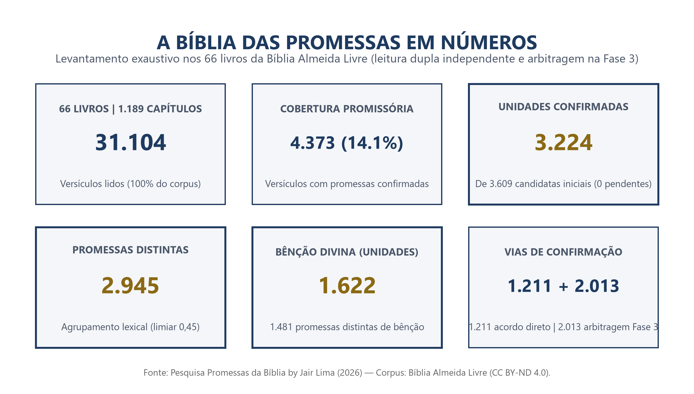

# Biblical Promises by Jair Lima (`Promessas-da-Biblia-by-Jair-Lima`)
**Scientific, Exegetical, and Computational Catalog of Promises Across the 66 Books of the Protestant Canon (v1.0.0)**  
*Author and Principal Investigator: **Jair Lima** (Lima Editora do Brasil)*

> 🇧🇷 **Versão em português em [README.md](README.md)** | 🌐 **Interactive Web App: [Biblical Promises Observatory](docs/index.html)** | 📄 **Scientific Paper: [ARTIGO_CIENTIFICO_PROMESSAS_DA_BIBLIA.md](ARTIGO_CIENTIFICO_PROMESSAS_DA_BIBLIA.md)**

---

## Key Research Findings at a Glance

| Official Research Metric | Confirmed Result | Notes |
| :--- | ---: | :--- |
| **Books, Chapters, and Verses Examined** | **66 / 1,189 / 31,104** | **100.0%** of the Protestant canon (*Bíblia Almeida Livre*) |
| **Initial Candidate Units (Phases 1–2)** | **3,609** | Preliminary union prior to Phase-3 arbitration |
| **Confirmed Promissory Units (Final Total)** | **3,224** | **Zero pending candidates** (`1,211` direct agreement + `2,013` arbitrated) |
| **Estimated Distinct Promises (Jaccard $\tau = 0.45$)** | **2,945** | Sensitivity range: `2,729` ($\tau=0.35$) to `3,096` ($\tau=0.65$); `3,506` recall-adjusted |
| **Verses Associated with Promises** | **4,373** | **14.1%** of all verses in the Bible |
| **Primary Indicator — Divine Blessing (Units)** | **1,622** | Divine blessing (`1,448`) + Apostolic guarantee (`161`) + Patriarchal blessing (`13`) |
| **Primary Indicator — Divine Blessing (Distinct)** | **1,481** | Up to `1,763` when adjusted by empirical recall ($0.84$) |

---

## 1. The Ten Taxonomic Categories & Three-Phase Reconciliation

1. **Divine blessing (`divina_bencao`):** 1,448 units (44.91%)
2. **Divine judgment (`divina_juizo`):** 952 units (29.53%)
3. **Human commitment of benefit (`humana_beneficio`):** 432 units (13.40%)
4. **Apostolic guarantee of blessing (`apostolica_garantia_bencao`):** 161 units (4.99%)
5. **Human commitment of harm (`humana_prejuizo`):** 82 units (2.54%)
6. **Divine sentence (`divina_sentenca`):** 73 units (2.26%)
7. **Apostolic guarantee of judgment (`apostolica_garantia_juizo`):** 37 units (1.15%)
8. **Adversarial or false promise (`adversaria_ou_falsa`):** 23 units (0.71%)
9. **Patriarchal blessing (`patriarcal_bencao`):** 13 units (0.40%)
10. **Patriarchal judgment (`patriarcal_juizo`):** 3 units (0.09%)

**Exact Mathematical Reconciliation (`3,609` preliminary $\rightarrow$ `3,224` confirmed):**
`3,609 (preliminary units) - 334 (units in 332 rejected false-positive cases) - 37 (excess subdivisions consolidated by the Phase-3 arbiter across 34 cases) - 14 (strict technical duplicates) = 3,224 confirmed promissory units`.

---

## 2. Repository Contents & Reproducibility

* `catalogo-digital-completo.csv` & `.xlsx`: Full dataset of all **3,224 confirmed promissory units**.
* `catalogo/<BOOK>/`: Individual JSONL and Markdown catalogs for each of the 66 biblical books.
* `MEMORIA_DE_CALCULO.md`: Complete calculation memory, threshold sensitivity analysis, and reconciliation of sapiential books (Proverbs: 1; Ecclesiastes: 0; Lamentations: 0).
* `ARTIGO_CIENTIFICO_PROMESSAS_DA_BIBLIA.md`: Full bilingual scientific paper.
* `evidencias_arbitragem_fase3/`: Input and output batches for all 1,808 Phase-3 arbitration cases.
* `scripts/` & `testes/`: Standard-library Python scripts and 77 automated validation tests.

---

## 3. Authorship, AI Disclosure & Licensing

* **Author and Principal Investigator:** **Jair Lima** (Lima Editora do Brasil).
* **Commercial Book:** This dataset underpins the book *As 3 Mil Promessas da Bíblia* by Jair Lima (Lima Editora do Brasil, 2026). The book's narrative chapters remain private and copyrighted.
* **Licenses:** Code under [MIT License](LICENSE); catalog metadata under [CC BY 4.0](LICENSE-DATA); biblical quotations from *Bíblia Almeida Livre by Jair Lima* under **CC BY-ND 4.0**.
