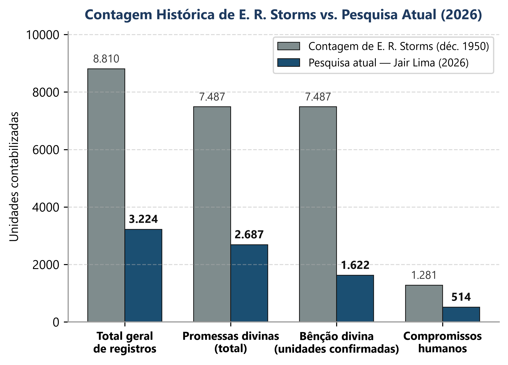

# Observatório das Promessas Bíblicas
**Uma investigação integral das promessas de Gênesis a Apocalipse**  
**Pesquisa e autoria: Jair Lima**  
*Lima Editora do Brasil, 2026*

[-2c5282.svg)](https://jairslima.github.io/Promessas-da-Biblia-by-Jair-Lima/)

> 🌐 **Portal Institucional e Consulta Interativa:** [**Observatório das Promessas Bíblicas**](https://jairslima.github.io/Promessas-da-Biblia-by-Jair-Lima/)  
> 📄 **Artigo Científico (PT/EN):** [**ARTIGO_CIENTIFICO_PROMESSAS_DA_BIBLIA.md**](ARTIGO_CIENTIFICO_PROMESSAS_DA_BIBLIA.md)  
> 🇬🇧 **English Documentation:** [**README.en.md**](README.en.md)

---

## Sobre a Pesquisa

O **Observatório das Promessas Bíblicas** é uma iniciativa de pesquisa de **Jair Lima**, desenvolvida a partir da investigação integral dos 66 livros do cânon protestante, utilizando como referência textual a *Bíblia Almeida Livre*.

O estudo foi estruturado em três etapas de identificação, conferência e arbitragem exegética, com auxílio de ferramentas computacionais de análise textual e processamento de linguagem natural.

A metodologia permitiu identificar, classificar e organizar **3.224 unidades promissórias**, das quais se estimam **2.945 compromissos distintos**.

Os resultados, critérios metodológicos, catálogos e memórias de cálculo são disponibilizados publicamente, permitindo sua consulta, verificação e utilização em estudos posteriores.

A concepção, a direção intelectual e a responsabilidade autoral da pesquisa pertencem a **Jair Lima**.

---

## 1. Resultados em Destaque

| Indicador Oficial da Pesquisa | Resultado | Detalhamento Metodológico |
| :--- | ---: | :--- |
| **Unidades promissórias confirmadas** | **3.224** | Contagem efetiva confirmada pelo método (`1.211` acordo direto + `2.013` arbitragem exegética) |
| **Promessas distintas estimadas** | **2.945** | Estimativa por agrupamento lexical (limiar de Jaccard 0,45; faixa de 2.729 a 3.096) |
| **Unidades de bênção divina** | **1.622** | Bênção divina (`1.448`) + Garantia apostólica de bênção (`161`) + Bênção patriarcal (`13`) |
| **Promessas distintas de bênção divina** | **1.481** | Estimativa lexical de compromissos distintos de bênção divina (limiar 0,45) |
| **Livros examinados** | **66** | 39 do Antigo Testamento e 27 do Novo Testamento (64 livros com registros catalogados) |
| **Capítulos investigados** | **1.189** | Cobertura integral dos capítulos do cânon protestante |
| **Versículos examinados** | **31.104** | **100%** do corpus da Bíblia Almeida Livre examinados versículo a versículo |
| **Versículos associados a promessas** | **4.373** | **14,1%** de todos os versículos da Bíblia contêm unidades promissórias confirmadas |
| **Categorias de classificação** | **10** | Taxonomia sistemática segundo a origem, a natureza e o promitente do compromisso |
| **Candidatos pendentes** | **0** | Zero candidatos ou divergências pendentes no catálogo consolidado |

*Nota sobre as grandezas:* A pesquisa distingue rigorosamente **contagem efetiva de unidades confirmadas** (`3.224`), **estimativa lexical de compromessas distintas** (`2.945` no limiar 0,45) e **projeção estatística corrigida pela revocação piloto de 0,84** (`3.506` no total e `1.763` de bênção divina, que constitui exercício analítico de sensibilidade e não medição exata).

---

## 2. Uma Nova Abordagem para o Estudo das Promessas Bíblicas

A pesquisa combina onze fundamentos metodológicos que permitem superar a repetição de números não verificáveis:

1. **Investigação integral do cânon protestante:** leitura completa dos 66 livros, 1.189 capítulos e 31.104 versículos, sem amostragem seletiva.
2. **Definição operacional de promessa:** fundamentada na teoria dos atos de fala comissivos, exigindo promitente identificável, compromisso futuro ou continuado e destinatário reconhecível.
3. **Classificação sistemática em dez categorias:** distinção entre bênção divina, juízo divino, sentença divina, garantias apostólicas (bênção e juízo), bênção e juízo patriarcais, compromissos humanos (benefício e prejuízo) e promessas adversárias ou falsas.
4. **Conferência cruzada dos resultados:** duas etapas iniciais de análise textual conduzidas de forma independente sobre todo o corpus.
5. **Arbitragem exegética das divergências:** terceira etapa de avaliação dedicada exclusivamente aos 1.808 casos de identificação unilateral ou divergência classificatória.
6. **Identificação de promitentes, comunicadores e destinatários:** separação formal entre o autor do compromisso (Deus, nos oráculos divinos e garantias apostólicas) e o comunicador humano que profetiza, relata ou recorda a palavra (1.487 registros, como em 1Cr 11.2).
7. **Distinção entre promessas, reafirmações e cumprimentos:** preservação de cada ocorrência no catálogo bruto combinada com agrupamento lexical objetivo para estimar promessas distintas.
8. **Documentação dos critérios de inclusão e exclusão:** separação clara entre atos promissórios, máximas sapienciais gerais (mais de 600 em Provérbios), declarações doutrinárias em terceira pessoa (como Ec 12.14 e Lm 3.22-32) e votos devocionais humanos.
9. **Disponibilização pública do conjunto de dados:** acesso aberto ao catálogo completo em CSV, Excel e JSONL por livro bíblico.
10. **Reprodutibilidade dos cálculos:** memória de cálculo explícita (`3.609 - 334 - 37 - 14 = 3.224`) e scripts de verificação utilizando apenas biblioteca padrão do Python.
11. **Contribuição para a teologia bíblica e as humanidades digitais:** diálogo documentado com a literatura histórica e contemporânea, sem reivindicar pioneirismo mundial absoluto sem comprovação bibliográfica.

---

## 3. O Mito das Oito Mil Promessas

A cifra de **8.810 promessas** (sendo **7.487 promessas de Deus ao ser humano**), amplamente citada na literatura homilética desde a segunda metade do século XX, remonta ao recenseamento manual realizado pelo professor canadense **Everek Richard Storms** (1914 a 1995), de Kitchener, Ontário, noticiado pela revista *Time* em 24 de dezembro de 1956 (seção *Religion*, "Promises") e difundido por **Herbert Lockyer** em *All the Promises of the Bible* (1962). Antes dele, **Samuel Clarke** (1720; 2. ed. 1738 com recomendação de **Isaac Watts**) organizara antologias pastorais temáticas sem finalidade estatística.

| Dimensão Comparada | Levantamento Histórico (E. R. Storms, 1956) | Pesquisa Atual (Jair Lima, 2026) |
| :--- | ---: | ---: |
| **Total de registros contabilizados** | 8.810 | **3.224 unidades confirmadas** |
| **Promessas distintas estimadas** | Não calculado | **2.945 promessas distintas** |
| **Promessas de origem divina (total)** | 7.487 (sem separação publicada entre bênção e juízo) | **2.687 unidades** (`1.622` bênção + `1.065` juízo/sentença) |
| **Promessas divinas de bênção** | Incluídas nas 7.487 | **1.622 unidades** (**1.481 distintas estimadas**) |
| **Compromissos humanos** | 1.281 (`991` pessoa a pessoa + `290` votos do homem a Deus) | **514 unidades** (votos humanos a Deus excluídos por definição) |
| **Catálogo público verificável versículo a versículo** | Não localizado nas fontes históricas | **Disponível integralmente (CSV, XLSX e JSONL)** |

A não reprodução do número 8.810 pela presente metodologia não desqualifica o esforço histórico de Storms nem o rotula como falso: demonstra apenas que contagens promissórias dependem dos critérios de definição e segmentação adotados, e que sob critérios comissivos explícitos e auditáveis o universo promissório das Escrituras situa-se na ordem de **três mil promessas**.

---

## 4. Organização do Conjunto de Dados e Documentação

* [`catalogo-digital-completo.csv`](catalogo-digital-completo.csv) e [`catalogo-digital-completo.xlsx`](catalogo-digital-completo.xlsx): Catálogo consolidado das **3.224 unidades promissórias confirmadas**.
* [`catalogo/`](catalogo/): Os 66 diretórios por livro bíblico (`<LIV>.jsonl`, `CATALOGO.md`, `CONTAGEM.md` e `cobertura.json`).
* [`ARTIGO_CIENTIFICO_PROMESSAS_DA_BIBLIA.md`](ARTIGO_CIENTIFICO_PROMESSAS_DA_BIBLIA.md): Artigo científico bilíngue (*Quantas promessas existem na Bíblia? Uma análise computacional e exegética dos 66 livros do cânon protestante*).
* [`MEMORIA_DE_CALCULO.md`](MEMORIA_DE_CALCULO.md): Memória de cálculo detalhada, conciliação aritmética das três etapas, análise de sensibilidade e exame de Provérbios (1), Eclesiastes (0, incluindo Ec 12.14) e Lamentações (0).
* [`RELATORIO_ORIGINALIDADE_CIENTIFICA.md`](RELATORIO_ORIGINALIDADE_CIENTIFICA.md): Revisão bibliográfica internacional e matriz comparativa.
* [`DICIONARIO_DE_CAMPOS.md`](DICIONARIO_DE_CAMPOS.md) e [`RELATORIO_LIMITACOES.md`](RELATORIO_LIMITACOES.md): Especificação das variáveis do conjunto de dados e limitações metodológicas.
* [`DOCUMENTACAO_TECNICA_REPRODUTIBILIDADE.md`](DOCUMENTACAO_TECNICA_REPRODUTIBILIDADE.md): Apêndice técnico com os procedimentos e parâmetros para reprodução computacional.
* [`evidencias_arbitragem_fase3/`](evidencias_arbitragem_fase3/): Registros históricos dos 36 lotes da terceira etapa de arbitragem (`1.808` casos).
* [`graficos/`](graficos/): Gráficos da pesquisa em alta resolução (450 DPI `.png` e vetoriais `.svg`), em cores (`_cor`) e em escala de cinza hachurada (`_pb`).
* [`docs/`](docs/): Portal público interativo do **Observatório das Promessas Bíblicas** (GitHub Pages).
* [`scripts/`](scripts/) e [`testes/`](testes/): Procedimentos de validação, consolidação, agrupamento lexical e 77 testes controlados.

---

## 5. Da Pesquisa ao Livro

Os resultados desta investigação fundamentam a obra **As 3 Mil Promessas da Bíblia: Da criação à eternidade: a história de um Deus que cumpre sua Palavra**, de **Jair Lima** (Lima Editora do Brasil, 2026).

Em sete partes e 53 capítulos, o autor conduz o leitor por uma jornada histórica, teológica e espiritual, revelando como as promessas atravessam as gerações e encontram sua expressão nos propósitos eternos de Deus.

A pesquisa permanece aberta à consulta pública. O livro desenvolve sua dimensão narrativa, exegética e pastoral. O manuscrito comercial e as edições da obra permanecem privados e protegidos por direitos autorais.

*Uma pesquisa para compreender as promessas. Uma obra para compreender aquele que promete.*

---

## 6. Sobre o Pesquisador

**Jair Lima** é pastor sênior da Assembleia de Deus de Três Coroas (RS), jornalista registrado (MTE nº 0024314/RS), escritor, capelão e membro da Academia de Letras dos Municípios do Rio Grande do Sul (ALMURS), da CGADB, do Conselho da CIEPADERGS e do IBDR, além de coordenador do GEIC (Grupo Ecumênico de Igrejas Cristãs de Três Coroas).

Possui formação interdisciplinar que une teologia, tecnologia da informação, governança e direito: é Especialista em Teologia (2024), Especialista em Direito Religioso (2025), com formação em *Derecho y Religión* pela Universidad Autónoma de Madrid (Espanha, 2025), Graduado em Redes de Computadores (2014), Pós-Graduado em Governança de TI (2015), Pós-Graduado em Tecnologia Google for Education (2019), Pós-Graduado em Investigação Forense e Perícia Criminal (2021), MBA em Contabilidade Empresarial (2022) e MBA em Design Thinking (2025). É autor da *Bíblia Almeida Livre*, da *Bíblia Católica Livre* e de obras teológicas e devocionais publicadas pela Lima Editora do Brasil.

* **Contato:** jairslima@gmail.com
* **Site oficial:** [www.jairlima.com.br](https://www.jairlima.com.br)
* **Mais informações:** [https://linktr.ee/Jairslima](https://linktr.ee/Jairslima)

---

## 7. Como Citar e Licenças

**Citação recomendada (ABNT):**
> LIMA, Jair. **Observatório das Promessas Bíblicas: Uma investigação integral das promessas de Gênesis a Apocalipse** (Conjunto de dados e catálogo estruturado v1.0.0: 3.224 unidades confirmadas e 2.945 promessas distintas estimadas). Três Coroas: Lima Editora do Brasil, 2026. Disponível em: https://jairslima.github.io/Promessas-da-Biblia-by-Jair-Lima/.

* **Código e scripts de análise (`scripts/`, `testes/`, `docs/`):** [MIT License](LICENSE) — Copyright (c) 2026 Jair Lima.
* **Catálogo analítico e metadados (`catalogo-digital-completo.*`, `MEMORIA_DE_CALCULO.md`):** [Creative Commons Attribution 4.0 International (CC BY 4.0)](LICENSE-DATA).
* **Texto bíblico de referência (*Bíblia Almeida Livre by Jair Lima*):** Creative Commons Atribuição-SemDerivações 4.0 Internacional (CC BY-ND 4.0).
