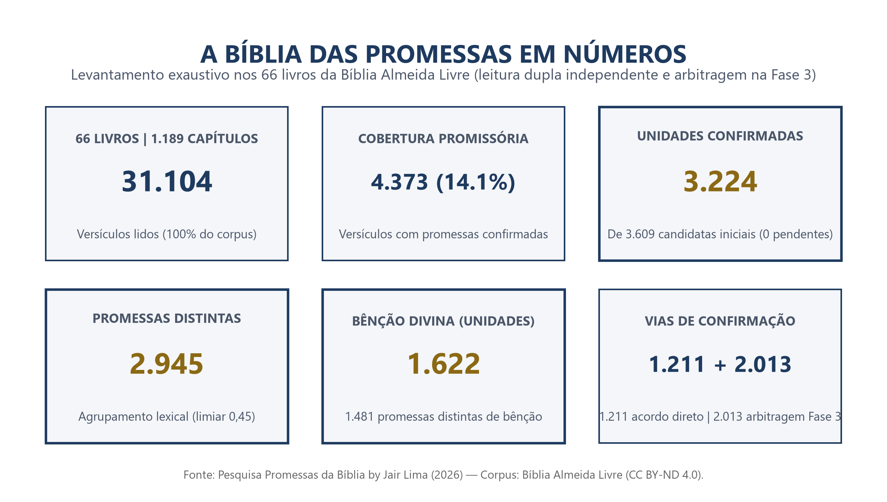
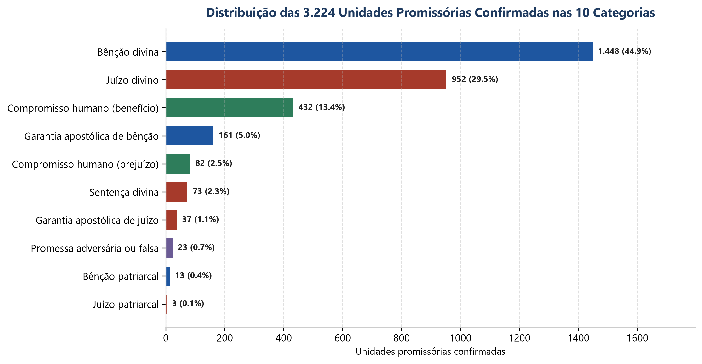
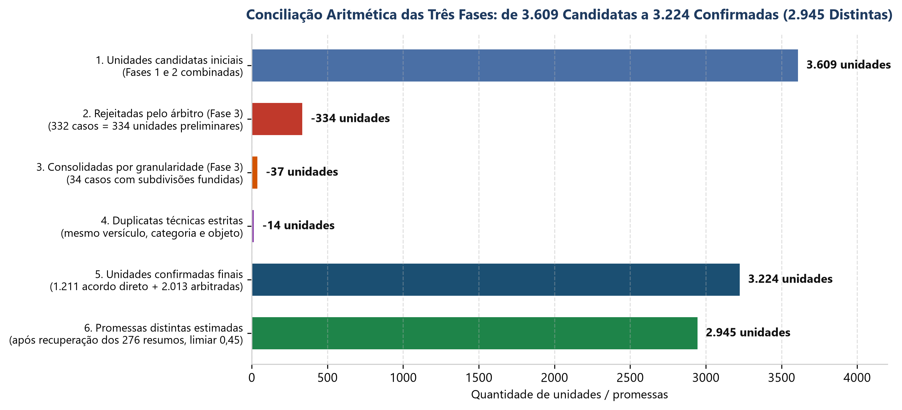

# Promessas da Bíblia by Jair Lima
**Catálogo Científico, Exegético e Computacional das Promessas nos 66 Livros do Cânon Protestante (v1.0.0)**  
*Autor e Pesquisador Responsável: **Jair Lima** (Lima Editora do Brasil)*

[](LICENSE)
[](LICENSE-DATA)
[-darkred.svg)](https://github.com/jairslima)

> 🇬🇧 **English version available in [README.en.md](README.en.md)** | 🌐 **Site interativo: [Observatório das Promessas Bíblicas](docs/index.html)** | 📄 **Artigo Científico: [ARTIGO_CIENTIFICO_PROMESSAS_DA_BIBLIA.md](ARTIGO_CIENTIFICO_PROMESSAS_DA_BIBLIA.md)**

---

## Os Resultados Principais em Números

| Indicador Oficial da Pesquisa | Resultado Confirmado | Detalhamento |
| :--- | ---: | :--- |
| **Livros, Capítulos e Versículos Lidos** | **66 / 1.189 / 31.104** | **100,0%** do cânon protestante (Bíblia Almeida Livre) |
| **Unidades Candidatas Preliminares (Fases 1–2)** | **3.609** | Levantamento inicial antes da arbitragem de 3ª fase |
| **Unidades Promissórias Confirmadas (Total Final)** | **3.224** | **Zero candidatos pendentes** (`1.211` acordo direto + `2.013` arbitradas) |
| **Promessas Distintas Estimadas (Jaccard $\tau = 0,45$)** | **2.945** | Faixa de sensibilidade: `2.729` ($\tau=0,35$) a `3.096` ($\tau=0,65$); até `3.506` c/ revocação |
| **Versículos Associados a Promessas** | **4.373** | **14,1%** de todos os versículos da Bíblia |
| **Indicador Principal — Bênção Divina (Unidades)** | **1.622** | Bênção divina (`1.448`) + Garantia apostólica (`161`) + Bênção patriarcal (`13`) |
| **Indicador Principal — Bênção Divina (Distintas)** | **1.481** | Até `1.763` na projeção corrigida pela revocação ($0,84$) |



---

## 1. As Dez Categorias e a Conciliação das Três Fases





### Equação Exata de Fechamento (`3.609` preliminares $\rightarrow$ `3.224` confirmadas):
* **1.808 casos divergentes** (contendo 1.882 unidades preliminares) foram submetidos ao terceiro agente árbitro independente na Fase 3:
  * **332 casos foram rejeitados** como falsos positivos (mandamentos sem garantia de benefício, votos humanos desiderativos, relatos consumados), removendo **334 unidades preliminares** (2 casos continham 2 subdivisões).
  * **1.476 casos foram confirmados**, gerando **1.511 unidades confirmadas** (32 casos abrigavam mais de um compromisso distinto, somando $+35$ unidades, enquanto em 34 casos em que um leitor havia pulverizado o trecho o árbitro escolheu a formulação coesa do outro leitor, consolidando **37 subdivisões excedentes**).
  * Foram removidas **14 duplicatas técnicas estritas** no mesmo versículo.
  * **Fórmula exata:** `3.609 - 334 (rejeitadas) - 37 (consolidadas por granularidade na arbitragem) - 14 (duplicatas estritas) = 3.224 unidades confirmadas`.

---

## 2. Estrutura do Repositório

* `catalogo-digital-completo.csv` e `catalogo-digital-completo.xlsx`: Catálogo completo das **3.224 unidades promissórias confirmadas**, com ID, livro, referência, categoria, objeto prometido (100% dos resumos preenchidos), promitente (com comunicador humano separado), destinatário, estado de validação e localização no livro comercial.
* `catalogo/<LIVRO>/`: Os 66 diretórios individuais por livro bíblico (`<LIV>.jsonl`, `CATALOGO.md`, `CONTAGEM.md` e `cobertura.json`).
* `MEMORIA_DE_CALCULO.md`: Memória de cálculo completa, conciliação das contagens, impacto da recuperação dos 276 resumos e análise de Provérbios (1), Eclesiastes (0, incluindo Ec 12.14) e Lamentações (0).
* `ARTIGO_CIENTIFICO_PROMESSAS_DA_BIBLIA.md`: Artigo científico completo bilíngue (*Quantas promessas existem na Bíblia? Uma análise computacional e exegética dos 66 livros do cânon protestante*).
* `RELATORIO_ORIGINALIDADE_CIENTIFICA.md`: Revisão bibliográfica internacional e matriz comparativa do estado da arte.
* `DICIONARIO_DE_CAMPOS.md` e `RELATORIO_LIMITACOES.md`: Especificação técnica de todas as variáveis e limitações metodológicas.
* `evidencias_arbitragem_fase3/`: Os 36 lotes de entrada e saída da Fase 3 de arbitragem exegética independente (`1.808` casos).
* `graficos/`: 12 gráficos em alta resolução (300 DPI), em versões coloridas (`_cor.png`) e monocromáticas para impressão (`_pb.png`).
* `docs/`: Site estático bilíngue (**Observatório das Promessas Bíblicas**) pronto para GitHub Pages.
* `scripts/` e `testes/`: Código-fonte Python (somente biblioteca padrão) e suíte de 77 testes automatizados.

---

## 3. Como Reproduzir os Resultados

Requer apenas **Python 3.10+** (biblioteca padrão para os cálculos e `matplotlib` para regenerar os gráficos):

```bash
# 1. Executar a suíte de 77 testes de validação de esquema e erros plantados
python -I testes/testes_erros_plantados.py

# 2. Recalcular as estimativas de promessas distintas e conferir a Memória de Cálculo
python -I scripts/apurar_numero.py
python -I scripts/memoria_de_calculo.py
```

---

## 4. Autoria, Uso de Inteligência Artificial e Obra Comercial

* **Autor e Responsável Intelectual:** **Jair Lima** (Lima Editora do Brasil).
* **Participação de Ferramentas de IA:** A leitura dupla independente dos 31.104 versículos (Fases 1 e 2) e a arbitragem cruzada dos 1.808 casos divergentes (Fase 3) utilizaram modelos de linguagem (Claude, DeepSeek V4.1 Flash High, Gemini e Codex) sob protocolo estrito elaborado pelo autor, em que o modelo árbitro de cada livro nunca coincidiu com os modelos leitores daquele livro, seguido de validação determinística de esquema e de âncoras literais por script Python.
* **Relação com o Livro Comercial:** Esta pesquisa fundamenta o livro ***As 3 Mil Promessas da Bíblia: Da criação à eternidade: a história de um Deus que cumpre sua Palavra***, de **Jair Lima** (Lima Editora do Brasil, 2026, 7 partes, 53 capítulos). O manuscrito literário do livro é privado e protegido por direitos autorais; este repositório disponibiliza exclusivamente os dados científicos, catálogos, scripts e relatórios metodológicos.

---

## 5. Licenças e Como Citar

* **Código-fonte (`scripts/`, `testes/`, `docs/`):** Licenciado sob [MIT License](LICENSE) — Copyright (c) 2026 Jair Lima.
* **Metadados e Catálogo (`catalogo-digital-completo.*`, `MEMORIA_DE_CALCULO.md`):** Licenciados sob [Creative Commons Attribution 4.0 International (CC BY 4.0)](LICENSE-DATA).
* **Citações Bíblicas nos Catálogos por Livro (`catalogo/*/`):** Extraídas da **Bíblia Almeida Livre by Jair Lima**, sob licença **Creative Commons Atribuição-SemDerivações 4.0 Internacional (CC BY-ND 4.0)** (proibida alteração da redação bíblica).

**Citação recomendada:**
> LIMA, Jair. *Promessas da Bíblia by Jair Lima: Catálogo Científico e Análise Computacional e Exegética dos 66 Livros do Cânon Protestante (v1.0.0)*. Três Coroas: Lima Editora do Brasil, 2026.
